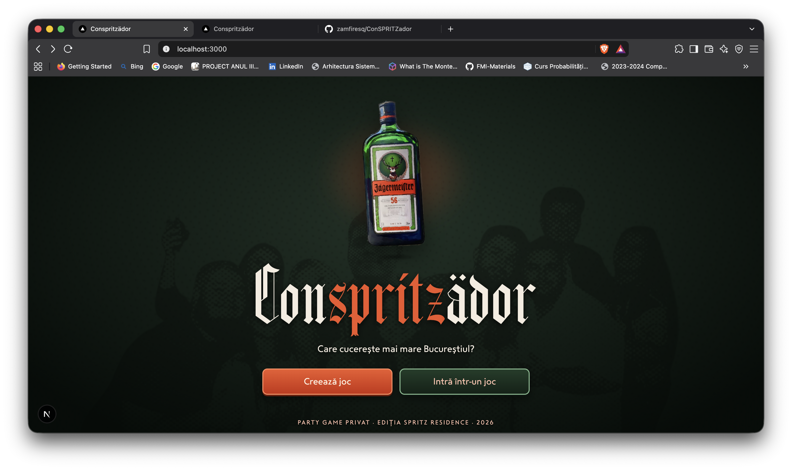
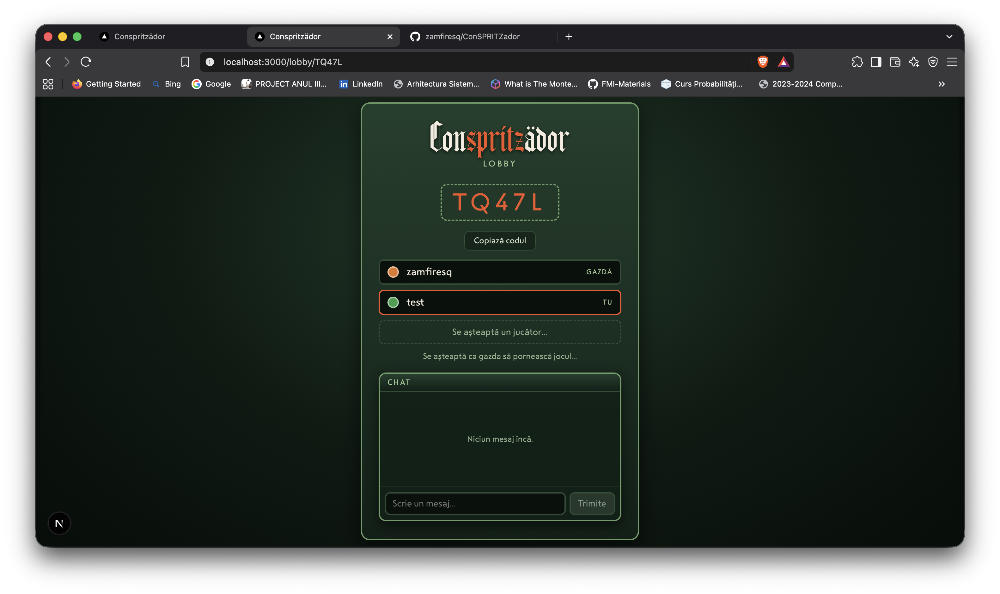
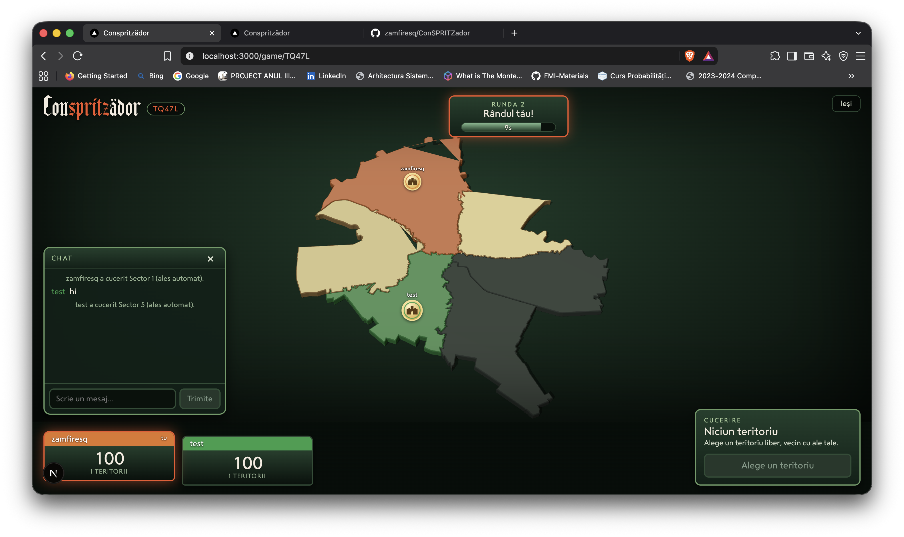

# ConSPRITZädor

ConSPRITZädor is a real-time multiplayer "trivia" and territory-conquest web game inspired by [Conquiztador](https://www.conquiztador2.ro/), built for friends and set on an interactive 3D map of Bucharest.




## Key Features

- **Room & Lobby System**: Create and join 3-player matches using unique 5-character room codes.

- **Interactive 3D Bucharest Map**: Extruded 3D districts rendered with *Three.js*.

- **Real-Time Sync & Chat**: Atomic turn updates powered by Firestore transactions, alongside an in-game chat with system alerts.





## Getting Started

1. Install dependencies:
```bash
cd frontend && npm install
cd ../functions && npm install
```

2. Configure your Firebase credentials in `.env`.

3. Run the development server:

```bash
cd frontend && npm run dev
```
